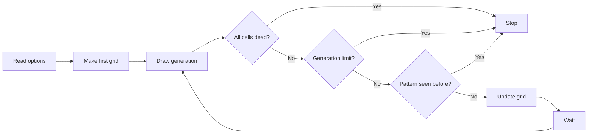

# Conway's Game of Life

This repository holds a small Conway's Game of Life simulator for the terminal.
The simulator is one Bash script: `bash/gol.sh`.
It draws a grid of cells. Each cell is alive or dead.
The grid changes one generation at a time.

John Conway made the Game of Life in 1970.
The game has no players. The first grid decides all later grids.

## Requirements

- Bash 3.2 or later. macOS has Bash 3.2 by default.
- A UTF-8 terminal for the block characters.
  The script uses ASCII characters when the terminal is not UTF-8.
- A terminal that understands ANSI escape codes for the live view.

The script uses Bash builtins and the standard `sleep` program.
It does not use `clear`, `tput`, or any other terminal program.

## Run the script

```sh
bash/gol.sh
```

If the file is not executable, run:

```sh
chmod +x bash/gol.sh
```

## Options

```text
Usage: gol.sh [options]

  -w N    Grid width, 1-200 (default 32)
  -h N    Grid height, 1-100 (default 16)
  -s N    Random seed, 0-32767 (default: random)
  -p P    Start pattern: random, blinker, glider, pentomino, acorn
  -d S    Delay between frames in seconds (default 0.5, 0 = fast)
  -n N    Stop after N generations (default 0 = no limit)
  -t      Wrap the grid at the edges (torus)
  -a      Use ASCII characters instead of blocks
  --help     Show the help text and exit
  --version  Show the version and exit
```

Notes:

- `-d 0` removes the delay. The script then runs at full speed.
  A zero delay does not start the `sleep` program.
- `-n 0` means no generation limit. Use `Ctrl-C` to stop.
- `-n N` stops after N updates. The script shows generation 0 and then N more generations.
- The script shows the effective seed in the status line.
  Bash can hold only 15 bits in `RANDOM`, so the seed range is 0-32767.
  A larger seed wraps to this range.
- The grid must have 20000 cells or less.
  This limit keeps one frame fast enough to watch.

## Start patterns

| Name      | Size  | Description                                  |
|-----------|-------|----------------------------------------------|
| random    | any   | Each cell starts alive or dead at random.    |
| blinker   | 3x1   | A line that turns by 90 degrees.             |
| glider    | 3x3   | A small shape that moves one cell diagonally.|
| pentomino | 3x3   | The R-pentomino. It makes a long, busy run.  |
| acorn     | 7x3   | A small shape with a long and complex life.  |

The script centers the pattern in the grid.
If the grid is smaller than the pattern, the script stops with an error.

## Examples

Start with the default random grid:

```sh
bash/gol.sh
```

Use a larger grid and a fixed seed:

```sh
bash/gol.sh -w 60 -h 30 -s 42
```

Watch a glider with a short delay:

```sh
bash/gol.sh -p glider -d 0.1
```

Watch an acorn on a grid with wrapped edges:

```sh
bash/gol.sh -p acorn -t -n 500
```

Use ASCII characters on a terminal without UTF-8:

```sh
bash/gol.sh -a
```

Write the frames to a file:

```sh
bash/gol.sh -n 10 -d 0 > frames.txt
```

## Exit conditions

The simulation stops for one of these reasons:

1. No cell is alive. The script reports `all cells are dead`.
2. A pattern returns. The script reports the period of the cycle.
3. The generation limit is reached. The script reports `generation limit reached`.
4. The user presses `Ctrl-C`. The script reports `interrupted`.

The script prints a final summary for every exit reason.
The summary gives the reason, the generation count, the live cell count, and the seed.

## How the script works

1. It reads the options and checks every value.
2. It makes the first grid. The grid uses `0` for a dead cell and `1` for a live cell.
3. It draws the grid. The draw step replaces `0` and `1` with display characters.
4. It tests the exit conditions.
5. It updates the grid with the four rules of Conway:
   - A live cell with fewer than two live neighbors dies.
   - A live cell with two or three live neighbors stays alive.
   - A live cell with more than three live neighbors dies.
   - A dead cell with exactly three live neighbors becomes alive.
6. It waits for the delay and repeats from step 3.

The script keeps the first 2000 states in memory.
It compares the current state with each earlier state.
A match means a cycle. The script then reports the cycle period.
A pattern with a period longer than 2000 generations is not detected.
This is a known limit.



## Test the script

Run the self-check:

```sh
bash bash/test_gol.sh
```

The check runs the script with fixed inputs.
It tests a cycle, a seed, a bad value, ASCII mode, and pipe output.

## Live view and output

The script checks if the output is a terminal.

- On a terminal, the script hides the cursor, clears the screen, and redraws in place.
  It shows the cursor again when it stops.
- In a pipe or a file, the script does not clear the screen.
  It writes a `--- generation N ---` line before each frame.
  This form is easy to read and easy to parse.

The status line under the grid shows the generation number, the live cell count,
the elapsed time, and the seed.

## Troubleshooting

**The block characters look broken.**
Your terminal or locale is not UTF-8. Use `-a` for ASCII characters.
You can also set a UTF-8 locale, for example `LC_ALL=C.UTF-8`.

**The script says `invalid option`.**
Use the short options in the table, or run `bash/gol.sh --help`.

**The grid wraps to the next line.**
The grid is wider than the terminal window.
Use a smaller `-w` value, or make the window wider.

**The simulation is slow.**
Bash is slow at large grids. Use a smaller grid.
Use `-d 0` to remove the delay.
A grid of 32x16 needs about 50 milliseconds for one generation on a modern laptop.

**The simulation stops too early.**
A random grid often ends in a short cycle.
Use a larger grid, a different seed, or a start pattern.
Use `-t` so a moving pattern does not hit the edge.

## Changelog

### 2.0.0

- Rewrite the update loop. It no longer starts a subshell for each cell.
- Keep full Bash 3.2 compatibility, including macOS.
- Add strict checks for every option value.
- Add base-10 parsing for values with leading zeros, such as `08`.
- Normalize the seed to the 15-bit `RANDOM` range and show the real seed.
- Add start patterns: blinker, glider, pentomino, and acorn.
- Add a torus mode with `-t`.
- Add a delay option, `-d`, and a generation limit, `-n`.
- Add cycle detection for any period, not only a still life.
- Add an ASCII mode and an automatic ASCII fallback for non-UTF-8 terminals.
- Add `--help` and `--version`.
- Add a final summary for every exit reason, including `Ctrl-C`.
- Hide and restore the cursor with a trap.
- Add clean output for pipes and files, with no screen clears.
- Pass ShellCheck with no warnings.
- Add a small self-check script, `bash/test_gol.sh`.

## License

See `LICENSE`.
